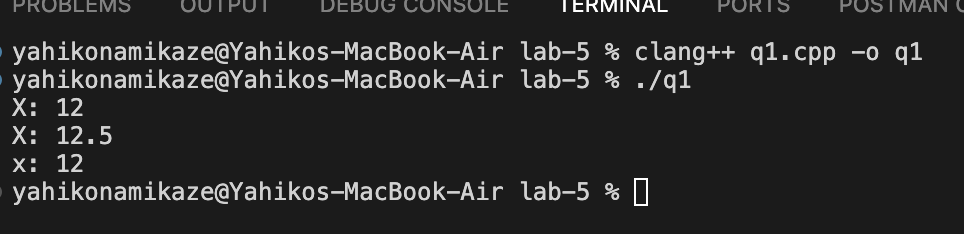
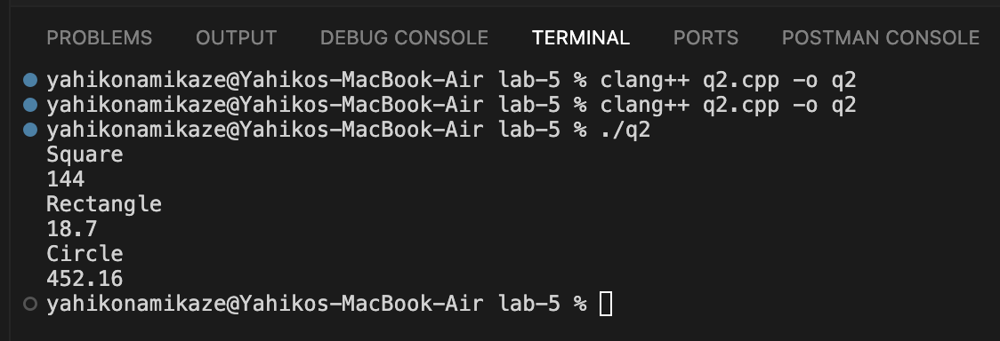
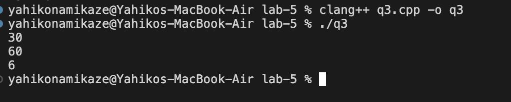
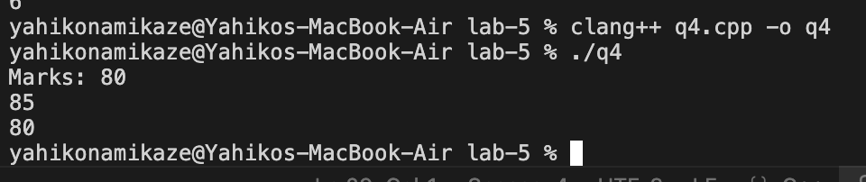
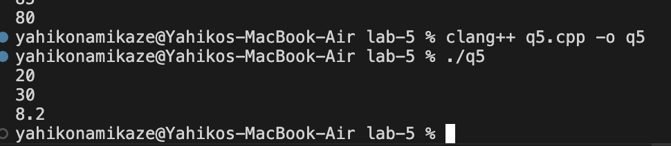
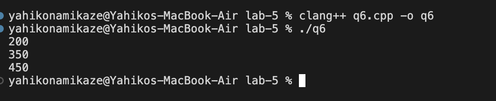

# Object Oriented Programming Lab Assignment - 5
## Polymorphism

## 1. 

**File:** [`q1.cpp`](./q1.cpp)

### Output

## 2. 

**File:** [`q2.cpp`](./q2.cpp)

### Output

## 3. 

**File:** [`q3.cpp`](./q3.cpp)

### Output

## 4. 

**File:** [`q4.cpp`](./q4.cpp)

### Output

## 5.

**File:** [`q5.cpp`](./q5.cpp)

### Output

## 6.

**File:** [`q5.cpp`](./q6.cpp)

### Output

